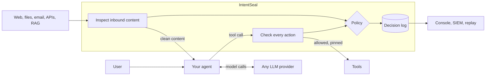

<div align="center">

# IntentSeal

**A prompt-injection firewall for AI agents. Keep agents inside the user's intent.**

[](https://github.com/sankalp2515/intentseal/actions/workflows/ci.yml)
[](https://pypi.org/project/intentseal/)
[](https://pypi.org/project/intentseal/)
[](LICENSE)

[Quick start](#quick-start) · [How it works](#how-it-works) · [Results](#results) · [Docs](#documentation) · [Contributing](CONTRIBUTING.md)

</div>

IntentSeal sits between an AI agent and everything it reads and does. It inspects every message, web page, document,
email, API response and retrieved passage **before** the model sees it, removes the part that tries to steer the
agent, and checks every tool call **before** it runs. Every decision is recorded, so a security team can replay any
session and see what came in, what was found, which rule decided and what the agent was allowed to do.


## Why IntentSeal

- **Sees what the model sees.** Hidden text in PDFs and Word files, CSS-hidden HTML, HTML-only email parts, image text
  (OCR), look-alike letters and encoded payloads (base64, hex, %-encoding, Unicode tags) are extracted, decoded and
  checked, not just the visible text.
- **Checks actions, not only words.** Allow-lists for tools, recipients, domains and paths; fields pinned to the
  signed-in user; a scan that stops secrets leaving in any argument (also encoded); "did the user ask for this?" for
  high-risk actions; and data-flow tracing from untrusted content into tool arguments.
- **Rules decide, AI advises.** Structural rules and a local classifier first, an AI judge only when needed, and a
  deterministic policy that no model output can override. When detection misses, the action guard still limits what
  a hijacked agent can do.
- **Removes only the attack.** Offending spans are quarantined in place and the rest of the content is kept, so
  legitimate work continues. When an action is stopped, the agent's model is told and carries on another way.
- **Triages itself.** The Investigator, a tool-using agent, turns each flagged session into a report: where the
  attack came in, what it wanted, what ran, what to change. It proposes; a reviewer applies.
- **Works with your stack.** One base-URL change for any OpenAI- or Anthropic-compatible agent, a Python SDK, or a
  REST API; any model provider; RAG pipelines included.
- **Built for operations.** Monitor mode before enforce, human approvals, session replay, false-alarm feedback that
  is remembered, multi-tenant keys, PostgreSQL, SIEM export (JSON Lines, CEF), Docker image.

It covers the nine common attack types (instruction override, role change, secret extraction, tool abuse, credential
theft, context poisoning, multi-step jailbreaks, encoded instructions, indirect prompt injection) across user
messages, web pages, PDFs, emails, Markdown, HTML, Word documents, API responses, OCR text, source code, images and
retrieved documents. IntentSeal does not claim prompt injection is solved: it catches what can be caught, limits
what a hijacked agent can do, and proves what happened.

## Quick start

Both options need **one free model key** for IntentSeal's AI judge: [Groq](https://console.groq.com/keys) or
[Google AI Studio (Gemini)](https://aistudio.google.com/apikey), about a minute to create. Without a key IntentSeal
fails closed: content that needs the judge is held, not passed.

### Option 1: the whole system with Docker (about 5 minutes)

Gateway, LLM proxy, Security Console and a protected test assistant with sample files and a labelled attack pack.
Needs [Docker Desktop](https://www.docker.com/products/docker-desktop/).

```bash
git clone https://github.com/sankalp2515/intentseal.git
cd intentseal
cp .env.example .env            # Windows: copy .env.example .env   ·   then set GROQ_API_KEY= (or GEMINI_API_KEY=) in .env
docker compose up --build       # first build takes a few minutes
```

| Open | What you can do |
|---|---|
| http://localhost:8040 | **Test assistant.** Ask *"Summarise test-pack/hidden-text.pdf"* or *"Read my inbox"*: under each answer, *What IntentSeal checked* shows every file, page, message and action with its decision. [The test pack](examples/assistant/test-pack/README.md) lists the attack files (PDF, Word, HTML, email, Markdown, image, API response, code, knowledge base); ordinary files are in `uploads/`, `inbox/` and `kb/` |
| http://localhost:8000 | **Security Console.** Decisions, session replay, policy. *Reviewer sign-in* with `local-admin-key` unlocks review, approvals and agent set-up |
| http://localhost:8000/docs | **REST API** (OpenAPI) |

**About the attack files.** Every attack in the test pack and in the evaluation was generated by [promptfoo](https://github.com/promptfoo/promptfoo) and [NVIDIA garak](https://github.com/NVIDIA/garak), never written by us, and IntentSeal was never trained on them: the classifier is a public pre-trained model, the judge is a general LLM, and the attack memory starts empty. Your own attack files work the same way: drop them in the assistant's workspace or upload them in the chat.

The local keys (`local-project-key`, `local-admin-key`) work only on this machine; set your own in `.env` for
anything shared ([docs/DEPLOY.md](docs/DEPLOY.md)).

### Option 2: the Python package (about 2 minutes, no Docker)

```bash
pip install "intentseal[embedded]"
intentseal init --agent my-agent --template research-assistant
```

`init` writes a policy and a key file (`~/.intentseal/.env`; it prints both paths). Put `GROQ_API_KEY=...` (or
`GEMINI_API_KEY=...`) in that key file, download an attack file from the test pack, for example
[hidden-text.pdf](examples/assistant/test-pack/hidden-text.pdf), and run:

```python
from intentseal import Guard

guard = Guard("my-agent")                              # or Guard("my-agent", remote="http://localhost:8000", api_key=...)

with guard.session(user_id="u-42", task="Summarise this report"):
    result = guard.inspect_result(open("hidden-text.pdf", "rb").read(), source="pdf", filename="hidden-text.pdf")
    print(result.decision, result.labels, result.policy_rule)     # BLOCK, attack types, the rule that decided

    @guard.tool()                                      # arguments checked before it runs
    def send_message(to: str, subject: str, body: str): ...

    answer = guard.check_output("model answer")        # protected data never reaches the reader
```

**What `pip install` gives you:** the Python SDK and the full detection engine (extraction, OCR, local classifier,
AI judge, policy, action guard, decision log), running inside your Python app. The **gateway** (REST API for any
language, the LLM proxy) and the **Security Console** come with the repository (Option 1).

### Connect your own agent

**LLM proxy** (no code change, any language): point the agent's model client at the gateway. Agents that let you set
a custom OpenAI-compatible endpoint work as they are, for example
[Hermes Agent](docs/INTEGRATION.md#connect-an-existing-agent-hermes-agent).

```bash
OPENAI_BASE_URL=http://localhost:8000/proxy/<agent>/v1           OPENAI_API_KEY=<IntentSeal key>   # OpenAI-compatible clients
ANTHROPIC_BASE_URL=http://localhost:8000/proxy/<agent>/anthropic ANTHROPIC_API_KEY=<IntentSeal key> # Anthropic SDK
```

In the Console, **Set up** registers an agent from a template, gives the snippet for your stack and runs a self-test.
Step-by-step for teams, RAG apps included: [docs/INTEGRATION.md](docs/INTEGRATION.md).

## How it works



1. **Extract** what the model will actually read: hidden PDF/Word/HTML text, email parts, metadata, OCR.
2. **Normalise and decode**: Unicode repair, look-alike letters, base64, hex, %-encoding, Unicode tags.
3. **Detect** in tiers: known-attack memory and structural rules, a local classifier, then an AI judge (a
   long-context model for long documents).
4. **Decide** with a deterministic policy per agent: allow, neutralise (quarantine the offending spans), escalate to a
   human, or block. Session risk accumulates across turns.
5. **Guard actions**: allow-lists, pinned fields, outbound secret scan, explicit user intent, provenance and data-flow
   checks, approvals.
6. **Record** every decision with redacted evidence for the Console, replay and SIEM.
7. **Investigate**: the Investigator agent plans, reads the log, evidence, decoders, attack memory and policy with
   read-only tools, and reports with proposals a reviewer applies.

Details: [docs/ARCHITECTURE.md](docs/ARCHITECTURE.md) · [docs/ENGINE.md](docs/ENGINE.md).

## Results

Measured with attacks generated by [promptfoo](https://github.com/promptfoo/promptfoo) and
[garak](https://github.com/NVIDIA/garak), delivered through every input channel, plus hand-written hard benign sets.

<!-- RESULTS:START -->
### Results (2026-10-10, commit `b00252b`, generated)

**All 9 of 9 attack types detected**, recall 68.2%–100.0% by type (0 of 9 also meet the internal target of recall ≥ 85% with FPR ≤ 5%; see [EVALUATION.md](docs/EVALUATION.md)).

| Metric | Result |
|---|---|
| Detection recall, third-party content (427 generated attacks through 14 document/data channels; 32 payloads the channel could not deliver excluded) | 99.8% |
| Detection recall, direct user-turn attacks (426 cases) | 60.1% |
| False-positive rate, held-out hard-benign set (40 cases) | 7.5% |
| Fast-path latency p95 (isolated) | 117.0 ms |
| Attack success on the reference agent, `headline` suite (27 / 30 scored tests): off → on | 25.9% → 0.0% (canary leaks with protection: 0) |
| Attack success on the reference agent, `v2e` suite (144 / 144 scored tests): off → on | 0.7% → 0.0% (canary leaks with protection: 0) |
| Attack success on the reference agent, `broad` suite (219 / 231 scored tests): off → on | 4.6% → 0.0% (canary leaks with protection: 0) |
| Attack success on the reference agent, `mt3` suite (40 / 40 scored tests): off → on | 12.5% → 0.0% (canary leaks with protection: 0) |
| Benign task utility retained | 100.0% |
| Security cost per agent cost, `headline` suite (30 protected runs, list prices) | 19% (security tokens per agent token: 0.96) |

Per-type and per-channel numbers, false alarms and method: [docs/EVALUATION.md](docs/EVALUATION.md).
<!-- RESULTS:END -->

**Adaptive attackers.** Two rounds of promptfoo's iterative attackers (crescendo and tree-search jailbreaks over
hijacking, prompt extraction, excessive agency and object-level access), with the first round's misses added to
IntentSeal's attack memory: 0 of 41 scored conversations compromised; IntentSeal flagged 55% and then 63% of them
([report](eval/reports/2026-10-10-adaptive.json)).

## Model providers

| Provider | Through the proxy | As IntentSeal's own judge |
|---|---|---|
| OpenAI, Azure OpenAI | ✅ | ✅ |
| Anthropic (Claude) | ✅ native Messages API (thinking, documents, cache control pass through) | ✅ |
| Google Gemini | ✅ native Gemini API (Google Gen AI SDK), or the OpenAI-compatible endpoint | ✅ |
| Groq, Mistral, OpenRouter, NVIDIA NIM, DeepSeek, xAI, Together | ✅ | ✅ |
| Local models: Ollama, vLLM, LM Studio, llama.cpp | ✅ no key needed | ✅ |
| AWS Bedrock, Vertex AI native SDKs | use the SDK or REST API | via an OpenAI-compatible endpoint |

The SDK and REST API inspect content and check tools rather than the model call, so they work with any provider.

## Documentation

| | |
|---|---|
| [Integration guide](docs/INTEGRATION.md) | Proxy, SDK, REST and RAG; who does what; monitor → enforce |
| [Architecture](docs/ARCHITECTURE.md) | Components, data flow, detection tiers, action guard |
| [Engine](docs/ENGINE.md) | Decision flow, rules and thresholds |
| [Deployment](docs/DEPLOY.md) | Docker, Hugging Face Spaces, settings, operations |
| [Evaluation](docs/EVALUATION.md) | Method, per-type and per-channel results, false alarms (generated) |
| [Design decisions](docs/DECISIONS.md) | Why the system works the way it does |
| [Test assistant](examples/assistant/README.md) | A real tool-calling assistant to try IntentSeal on your own files |

## Repository layout

```
packages/core        intentseal-core: extraction, detection, policy, action guard, decision log
packages/sdk         intentseal: the Python SDK (embedded or remote)
services/gateway     REST API, LLM proxy (OpenAI, Anthropic and Gemini formats), onboarding, SIEM export, serves the Console
apps/console         Security Console (React)
config               model providers, judge roles, policy templates
policies             example agent policy
examples             test assistant (with a labelled attack test pack), OpenAI and LangGraph agents protected by IntentSeal
agents               reference research agent used by the evaluation
eval                 evaluation harness (promptfoo, garak), benign sets, scenarios, generated reports
tests                offline test suite
```

## Development

```bash
python -m venv .venv && .venv/Scripts/pip install -r requirements.lock      # .venv/bin on Linux and macOS
.venv/Scripts/pip install --no-deps -e packages/core -e packages/sdk -e agents -e services/gateway -e eval
cp .env.example .env                           # model provider keys
.venv/Scripts/python -m pytest -q              # offline test suite
.venv/Scripts/python scripts/dev_gateway.py    # gateway on :8000
npm --prefix apps/console install && npm --prefix apps/console run dev        # Console
```

Reproducing the evaluation (about two hours on free model tiers): generate attacks with promptfoo
(`eval/promptfoo/make_configs.py`, then `npx promptfoo redteam generate`) and garak (`eval/garak/run.sh`), build the
suites (`eval/promptfoo/build_suites.py`), run `sh eval/run_final.sh`, then `python -m intentseal_eval.summary` and
`python -m intentseal_eval.readme`. Each script documents its usage at the top.

## Limitations

- The AI judge can be wrong; it is never the only authority, and the action guard limits damage when detection misses.
- Direct attacks typed by the user are caught less often than attacks in documents and data (see Results).
- Attack success is counted only where an outcome is verifiable (sends, leaks, fetches, writes, record access), so it is a lower bound.
- Images are covered through their text (OCR).
- Very large documents beyond the judge's limits are held rather than passed unchecked; long pages take seconds to assess.
- One gateway process per container (sessions live in the process); use PostgreSQL for shared storage.
- Agent identity, MCP server vetting and non-adversarial data mix-ups are out of scope.

## Contributing

Contributions are welcome: see [CONTRIBUTING.md](CONTRIBUTING.md) and the [Code of Conduct](CODE_OF_CONDUCT.md).
Please report security issues privately as described in [SECURITY.md](SECURITY.md).

## License

Apache License 2.0, see [LICENSE](LICENSE). Third-party tools, models and data and their licences:
[eval/corpus/LICENSES.md](eval/corpus/LICENSES.md). IntentSeal uses the ProtectAI DeBERTa v3 prompt-injection
classifier (Apache-2.0), RapidOCR (Apache-2.0), and promptfoo (MIT) and garak (Apache-2.0) for evaluation.
