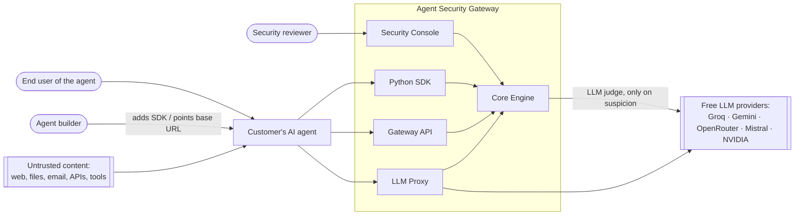
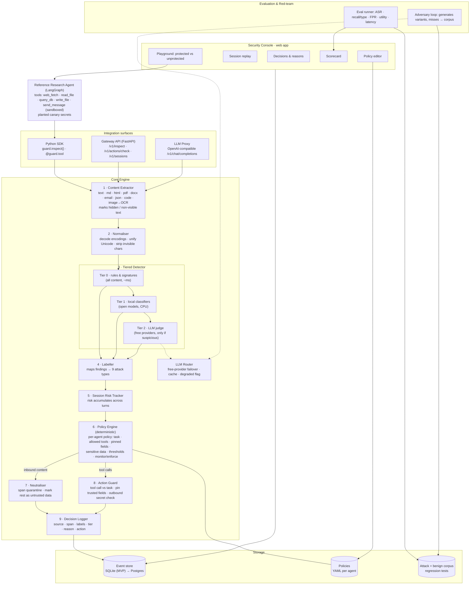
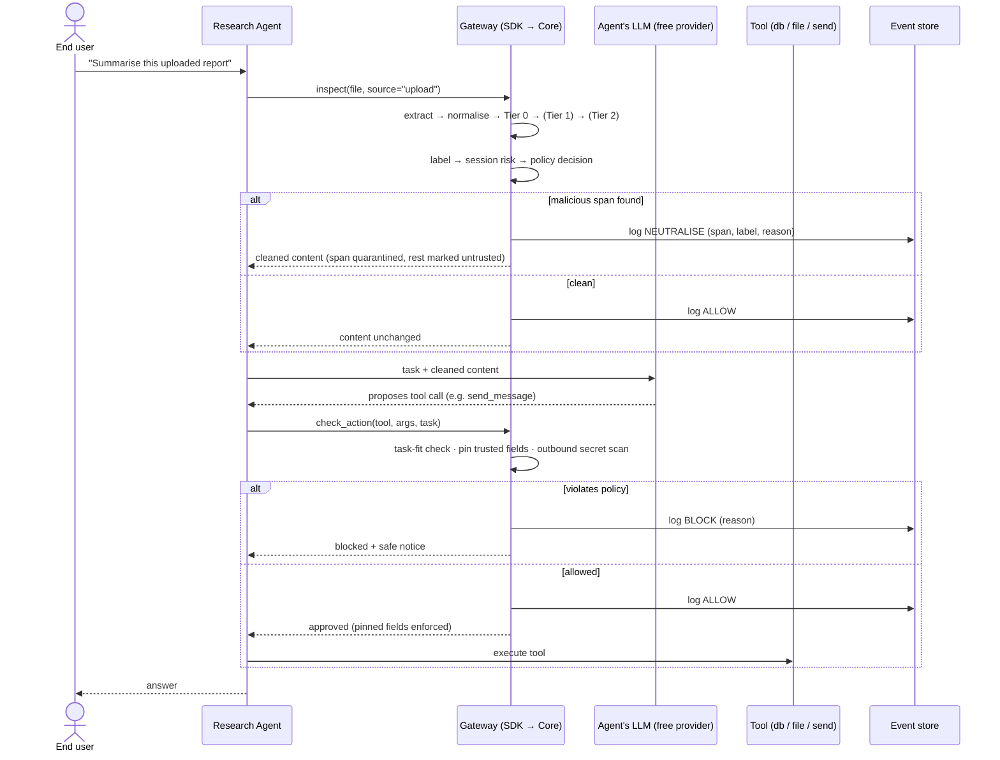
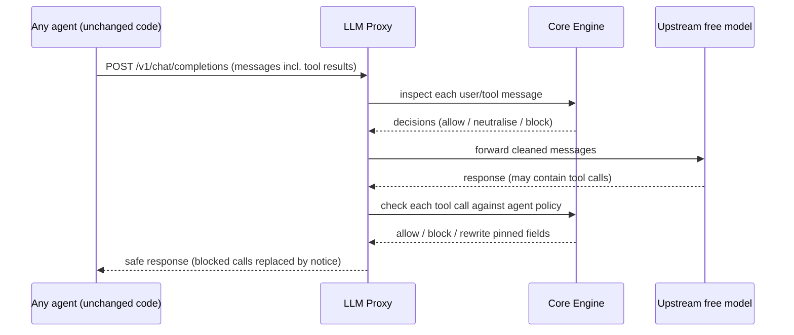
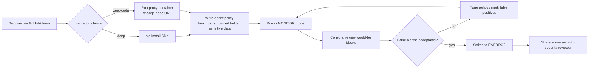
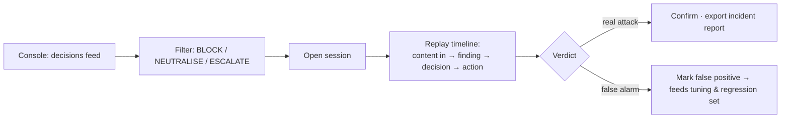
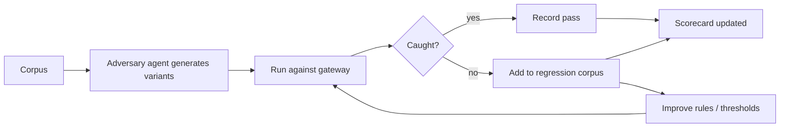

# 09 — System Design, Architecture, User Flows & Journeys

> Stage: **Design** (no code yet). Implements PRD docs/07 (P0 R1–R16 + R23).
> Product form (decided 4 Oct): **Core Engine + Python SDK + Gateway API + LLM Proxy + Security Console.**
> Models: **free tiers only** (Groq, Gemini, OpenRouter, Mistral, NVIDIA) + **free local models**.
> Mermaid diagrams below render in GitHub and most Markdown viewers.

---

## 1. Design principles

| # | Principle | Why (evidence) |
|---|---|---|
| P1 | **One engine, many entry points.** SDK, API and proxy all call the same engine | Consistent decisions; one thing to test |
| P2 | **Rules decide; AI advises.** Final allow / neutralise / block comes from a deterministic policy engine | An AI judge can itself be manipulated (row 6) |
| P3 | **Cheap first, deep on suspicion.** Rules → local classifiers → LLM judge | Latency and free-tier rate limits |
| P4 | **Every channel, every action.** Inspect all inbound content *and* every tool call | Filters watching only the chat box failed (row 33); #1 pain is excess authority (T3) |
| P5 | **Explain everything.** Every decision stores source, span, labels, tier and reason | Reviewers need replay (row 38) |
| P6 | **Fail safe, never silent.** If an AI tier is down, fall back to rules and mark "degraded" | Free providers fail often |
| P7 | **Model-agnostic and config-driven.** Providers and models live in config, with failover | Free model lineups change |

---

## 2. System context (who and what touches the system)



---

## 3. Full architecture



### Component responsibilities

| # | Component | Input → output | PRD reqs | Notes |
|---|---|---|---|---|
| 1 | Content Extractor | raw content + source type → full text view with visible/hidden flags | R1, R2, R21 | "See what the model sees". Licence-safe libraries (avoid AGPL in core) |
| 2 | Normaliser | text → normalised text + list of transformations applied | R3 | Detection runs on the normalised view; the agent receives the original minus neutralised spans |
| 3 | Tiered Detector | normalised text → suspicious spans with scores | R4 | T0 every input; T1 when T0 is inconclusive or content is untrusted; T2 only when T1 is suspicious or uncertain |
| 4 | Labeller | spans → one or more of the 9 attack-type labels | R5 | Needed for the F-axis claim |
| 5 | Session Risk Tracker | per-session events → cumulative risk | R10 | Catches multi-step attacks |
| 6 | Policy Engine | labels + scores + session risk + agent policy → decision | R12 | Deterministic. Decisions: ALLOW · NEUTRALISE · BLOCK · ESCALATE |
| 7 | Neutraliser | content + spans → cleaned content, spans quarantined and wrapped as untrusted data | R6 | Keeps legitimate content usable |
| 8 | Action Guard | proposed tool call + task + policy → allow / block / rewrite pinned fields | R7, R8, R9 | Outbound check scans tool arguments and outgoing messages for secrets and canaries |
| 9 | Decision Logger | every decision → event record | R11 | Basis for replay and scorecard |
| — | LLM Router | judge/generator requests → free providers with failover and cache | R13 | Marks results "degraded" when it falls back to rules |
| — | Eval runner + adversary loop | corpus → metrics; misses → new regression cases | R15, R17 | Produces the scorecard and the hackathon evaluation report |
| — | Reference Research Agent | user's research tasks | R14 | Built fresh. Outbound "send" is sandboxed (writes to a local outbox, never real email) |

### Decision model (Policy Engine output)

| Decision | When | Effect |
|---|---|---|
| ALLOW | No finding, or below threshold | Content/action passes unchanged |
| NEUTRALISE | Malicious span found in otherwise useful content | Span quarantined; rest passes, marked as untrusted data |
| BLOCK | High-risk content or an action that breaks policy | Content withheld / tool call stopped; agent receives a safe notice |
| ESCALATE | High-risk action that may still be legitimate | Human approves or rejects with a readable explanation (P1 R20). Kept rare by design |

In **monitor mode**, every decision is logged but only ALLOW is enforced.

---

## 4. How each surface plugs in

| Surface | How a builder adopts it | What it sees | What it can enforce | Limitation |
|---|---|---|---|---|
| **Python SDK** | `pip install`, write policy, wrap content loaders and tools | Raw files *before* extraction, every tool call, trusted context | Everything: inbound, actions, pinned fields, outbound | Needs a small code change; Python only |
| **Gateway API** | Run container; call `/v1/inspect` and `/v1/actions/check` | Whatever the caller sends | Returns decisions; caller applies them | Caller must call it at the right places |
| **LLM Proxy** | Change the agent's API base URL (+ an agent-id header) | All messages to the model (incl. tool results) and the model's tool calls | Inspect/neutralise inbound messages; block or rewrite tool calls in the response | Sees text only (files already extracted by the agent); cannot stop tools the agent runs without asking the model |
| **Security Console** | Open the web app | Event store, policies, scorecard | Policy edits, monitor/enforce toggle, approvals | Reviewer-facing; not in the request path |

---

## 5. Runtime flow: one protected request (SDK path)



### Proxy path (zero-code)



---

## 6. User flows

### F1 — Builder onboarding (SDK or proxy)


### F2 — Reviewer investigation


### F3 — Adversary loop (trainability)


### F4 — Judge / visitor demo (public link)
1. Open the Console **Playground** → pick a scenario (e.g. "Report with hidden instruction", "Email asking to forward secrets", "Multi-step").
2. Run **unprotected** → the agent is hijacked; a canary secret appears in the sandboxed outbox.
3. Run **protected** → the span is quarantined / the tool call is blocked; the agent completes the legitimate task.
4. Click **Replay** → see the exact span, attack-type label, tier and reason.
5. Open **Scorecard** → measured recall per attack type, false-alarm rate, latency, grid claim.

---

## 7. User journeys

### Builder (agent developer / platform lead)

| Stage | Aware | Try | Integrate | Monitor | Enforce | Get approval |
|---|---|---|---|---|---|---|
| **Doing** | Sees an incident write-up or a security-review blocker | Opens public Playground | Adds SDK or points proxy | Watches would-be blocks | Turns on enforce | Sends scorecard + replay to security |
| **Touchpoint** | README, demo video | Console Playground | Docs, policy file | Console decisions | Policy toggle | Scorecard export |
| **Feeling** | Anxious: "are we exposed?" | Curious | Wary of effort | Relieved / annoyed by false alarms | Confident | Unblocked |
| **Pain addressed** | Row 13 "asking an LLM nicely" | — | Rebuild fear | Row 5 "disable within a day" | Row 33 unwatched channels | Row 36 review bottleneck |
| **Must get right** | Clear one-line promise | Works in < 1 min, no signup | ≤ 10 lines / 1 setting | Readable reasons, easy tuning | No utility loss | Evidence a reviewer trusts |

### Reviewer (security / risk)

| Stage | Asked to approve | Inspect evidence | Investigate | Decide | Ongoing |
|---|---|---|---|---|---|
| **Doing** | Receives agent for review | Reads scorecard | Replays sessions | Approves with conditions | Gets alerts, reviews escalations |
| **Touchpoint** | Scorecard link | Scorecard page | Session replay | Policy page | Decisions feed |
| **Feeling** | Sceptical of vendor claims | Wants numbers on *this* agent | Wants to see exactly what happened | Accountable | Fatigue risk |
| **Pain addressed** | Row 40 vendor over-reliance | Contradiction 2 (claims not comparable) | Row 38 session replay | — | Row 56 approval fatigue |
| **Must get right** | Measured, reproducible | Per-attack-type breakdown | Span-level evidence | Clear policy | Escalations rare and specific |

---

## 8. Console wireframes (low fidelity)

```
┌ Playground ───────────────────────────────────────────────────────────┐
│ Scenario: [Report with hidden instruction ▾]   Protection: (●) ON ( ) OFF │
│ ┌ Agent conversation ───────────┐ ┌ Gateway activity ─────────────────┐ │
│ │ User: Summarise this report   │ │ 12:01 upload  NEUTRALISE           │ │
│ │ Agent: Here is the summary…   │ │   span #3 · Indirect injection     │ │
│ │                               │ │   tier 1 · "instruction to send…"  │ │
│ └───────────────────────────────┘ │ 12:01 send_message  BLOCK          │ │
│ Outbox (sandbox): 0 messages      │   reason: not part of task         │ │
│ Canary leaked: NO ✅              └───────────────────────────────────┘ │
└───────────────────────────────────────────────────────────────────────┘

┌ Session replay ───────────────────────────────────────────────────────┐
│ ① user msg ─ ② file in ─ ③ NEUTRALISE ─ ④ tool call ─ ⑤ BLOCK ─ ⑥ answer │
│ [③ selected] Source: upload.pdf (hidden text, page 4)                   │
│ Span: ████████ (quarantined)   Labels: Indirect · Secret extraction     │
│ Tier: 1 → 2 (judge agreed)     Policy rule: untrusted-instruction       │
└───────────────────────────────────────────────────────────────────────┘

┌ Scorecard: research-agent ────────────────────────────────────────────┐
│ Attack type            Recall   │ False-alarm rate (hard benign): 3.1%  │
│ Instruction override   96% ████ │ Utility retention: 94%                │
│ Indirect injection     91% ███▌ │ p95 added latency (fast tier): 85 ms  │
│ …                               │ Claim: F3 / D2 (measured 9 Oct)       │
└───────────────────────────────────────────────────────────────────────┘
```
*(Numbers in wireframes are placeholders, not results.)*

Other screens: **Decisions feed** (filterable list), **Policy editor** (task, tools, pinned fields, thresholds, monitor/enforce).

---

## 9. Technology choices (all free / open)

| Layer | Choice | Why |
|---|---|---|
| Language | Python 3.11 | Agent ecosystem, ML libraries, your strength |
| API / proxy | FastAPI + httpx | Async, OpenAI-compatible proxy is straightforward |
| Reference agent | LangGraph | Your strength; common framework (good integration proof) |
| Extraction | pypdf / pdfplumber, python-docx, BeautifulSoup, email stdlib, RapidOCR (images) | Permissive licences; avoids AGPL in a product core |
| Local classifiers | Open prompt-injection classifiers on Hugging Face (e.g. ProtectAI DeBERTa v2, Apache-2.0; Meta Prompt Guard 2, Llama licence, gated) | Free, CPU-capable; licences checked before use |
| LLM judge / generator | Router over Groq, Gemini, OpenRouter, Mistral, NVIDIA free tiers | Failover; config-driven |
| Storage | SQLite (MVP), schema portable to Postgres | Zero ops on free hosting |
| Console | React + Vite + Tailwind | Fast, static-hostable |
| Hosting | Backend (API + proxy + agent + classifiers) as one Docker container on **Hugging Face Spaces** (free CPU tier has enough RAM for small models); Console static on Vercel/Netlify/Cloudflare Pages | Free; public links |
| Testing | pytest + eval harness | Reproducible metrics |

---

## 10. Riskiest assumptions → cheap tests (Validate stage, before building)

| # | Assumption | If wrong… | Cheap test (≈2–3 h total, Day 2 morning) |
|---|---|---|---|
| A1 | Free models call tools reliably *and* are hijackable when unprotected | No baseline, no demo | Run ~20 corpus scenarios on Groq Llama and Gemini Flash |
| A2 | Local classifiers catch indirect/hidden content with acceptable false alarms after normalisation | Detection leans too hard on rate-limited LLM judge | Run 2 classifiers on a 100-item sample; measure recall/FPR |
| A3 | Free-tier quotas cover evaluation volume (~2–3k judge calls) | Eval can't finish | Check quotas; estimate with caching and Tier-2 escalation rate |
| A4 | Hugging Face Spaces runs API + classifiers within RAM and acceptable latency | Need another host | Deploy a hello-world container with one classifier |
| A5 | Proxy can parse tool calls from multiple free providers' OpenAI-compatible endpoints | R23 at risk | Send one tool-calling request via 2 providers through a stub proxy |
| A6 | Span-level neutralisation keeps the agent useful | Utility drops | Run 10 benign tasks with spans removed |

Outcome of these tests may change thresholds, the model list or hosting, **not** the problem or the architecture.

---

## 11. Revised timeline (design added; proxy now P0)

| Day | Date | Focus |
|---|---|---|
| 1 | Sat 4 Oct | **Design** (this doc) · sign-off |
| 2 | Sun 5 Oct | **Validate** A1–A6 (morning) · repo · reference agent · corpus v0 · baseline |
| 3 | Mon 6 Oct | Engine: extractor, normaliser, tiered detector, labeller, policy, neutraliser |
| 4 | Tue 7 Oct | Action guard, pinned fields, outbound check, session risk · SDK |
| 5 | Wed 8 Oct | Gateway API · **LLM proxy (R23)** · decision log · fail-safe |
| 6 | Thu 9 Oct | Console (Playground, replay, scorecard) · full evaluation · deploy |
| 7 | Fri 10 Oct | Adversary loop (if time) · architecture doc · README · deck · video |
| 8 | Sat 11 Oct | Buffer · submit by evening |

**Cut order if behind:** adversary loop (R17) → OCR (R21) → approvals UI (R20) → policy editor UI (keep YAML) → Gateway API docs polish. P0s, including the proxy, are not cut; if one slips, the grid claim is lowered rather than overstated.
