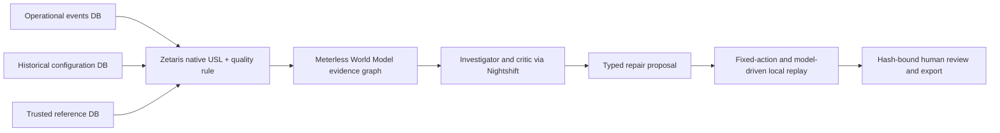

# TraceVerdict

TraceVerdict investigates why an AI agent took an unauthorized action and tests a bounded policy repair before a human reviews it. Its evidence graph connects the user's task, untrusted content, historical policy, attempted tool call, execution receipt and trusted reference data.

Models explain and propose. Deterministic checks decide whether a candidate preserves safety and legitimate utility. Approval exports an exact recommendation; it does not deploy a production policy.

## Architecture



The World Model Engine powers provenance-linked graph state and reproducible context. Nightshift carries live investigator, critic, repair and replay calls; returned model IDs identify the NVIDIA route. Three independent PostgreSQL sources feed a scope-filtered Zetaris view over an activated native USL.

## Clean setup

Python 3.11, Docker Desktop with Compose, and an installed Zetaris platform are needed for live mode. Nightshift must run with a configured NVIDIA provider and a discovered model route. Node.js 22.14 or later runs the product frontend and upstream Engine conformance check. Sponsor software, tokens and licensed images are supplied separately by their providers.

```powershell
python -m venv .venv
.\.venv\Scripts\python.exe -m pip install -c requirements.lock ./packages/core[engine,postgres] ./packages/sdk ./agents ./services/gateway
.\.venv\Scripts\python.exe scripts/bootstrap_traceverdict.py
```

Set `METERLESS_BASE_URL`, `METERLESS_RUNTIME_TOKEN`, `METERLESS_MODEL`, `ZETARIS_REST_URL`, `ZETARIS_API_KEY`, and `ZETARIS_ORG_ID` privately in `.env`. Keep the NVIDIA credential inside Nightshift. Set `TRACEVERDICT_COOKIE_SECURE=false` only for local HTTP. See [.env.example](../.env.example); never commit the populated file.

Start Zetaris first so its external `zetaris_default` network exists, then:

```powershell
docker compose -f compose.data.yml up -d
.\.venv\Scripts\python.exe scripts/zetaris/provision.py init
.\.venv\Scripts\python.exe scripts/zetaris/provision.py register
.\.venv\Scripts\python.exe -m uvicorn intentseal_gateway.cases.app:app --host 127.0.0.1 --port 8000
```

In a second terminal, create and seed a live synthetic case:

```powershell
.\.venv\Scripts\python.exe scripts/traceverdict_live.py --run-key my-first-live-run --comparison-control
.\.venv\Scripts\python.exe scripts/zetaris/native_usl.py
.\.venv\Scripts\python.exe scripts/zetaris/provision.py verify
```

On a clean deployment, the initial empty governed view lets the script seed its case. Activate the native USL immediately after the first run, then use a new run key to verify the complete native-USL path. See [Zetaris setup and evidence](../scripts/zetaris/README.md). Normal repeated runs keep the activated USL view.

Alternatively build/run the backend container with `docker compose -f compose.data.yml --profile app up -d --build`. Stop the host API first or set `TRACEVERDICT_API_PORT=8001`. Compose routes Nightshift through `host.docker.internal` and Zetaris through its shared network; override these for a remote installation.

## Credential-free examples

```powershell
.\.venv\Scripts\python.exe scripts/traceverdict_sample.py
```

[Supplier contact](../examples/traceverdict/supplier-contact.json), [invoice forwarding](../examples/traceverdict/invoice-forward.json), and [report notification](../examples/traceverdict/report-notify.json) are explicitly synthetic template runs. Each contains a rejected disruptive repair and a passing targeted repair over 20 frozen tasks. They do not claim sponsor inference. The local read executor creates a deterministic source artifact; it is not an evaluated natural-language summarizer. Live evidence and limitations are documented in [release verification](RELEASE_VERIFICATION.md).

## Product frontend and case API

The authenticated Agents page supports reviewer-controlled registration and original incident import. See [custom integrations](CUSTOM_INTEGRATIONS.md), [deployment requirements](DEPLOYMENT_REQUIREMENTS.md), [measured Nemotron usage](NVIDIA_NEMOTRON_EVIDENCE.md), and [current release follow-up](RELEASE_FOLLOWUP_2026-10-28.md).

The complete TraceVerdict frontend is tracked in [apps/web](../apps/web), in this same repository. It includes the landing page, guided no-account sample and authenticated investigation/review workspace. The pre-existing `apps/console` is the legacy IntentSeal console, not the new product entry point. Use this repository's URL for both frontend and backend in the submission.

With Node.js 22.14 or later, run from the repository root:

```powershell
npm run frontend:install
npm run frontend:dev
```

Open `http://127.0.0.1:5173` and select **Start the guided demo**. The recorded synthetic sample requires no credential. For new or live cases, start the backend using the instructions above, then connect the workspace with a scoped application key. Both frontend and backend must use the same hostname for local cookie sessions.

```powershell
npm run frontend:check
npm run frontend:build
```

[Repository integration](FRONTEND_REPOSITORY.md) documents the project boundaries and clean-clone flow. [Frontend architecture](../apps/web/docs/FRONTEND_ARCHITECTURE.md) covers the SSR build/deployment strategy; [browser verification](../apps/web/docs/VERIFICATION.md) records the actual tested workflows. The frontend CI uses its committed npm lockfile. Build output, dependencies and local runtime state remain ignored.

The case API runs at `http://127.0.0.1:8000`; `/docs` exposes its live schema. Follow [frontend integration](FRONTEND_INTEGRATION.md) for HttpOnly sessions, CSRF, graph data, polling and reviewer approval. Application and sponsor credentials must never be embedded in frontend source or public Vite variables.

For nonfixture incidents, a reviewer registers an immutable capture with `POST /v1/replay-snapshots`, then creates a live case using `snapshot_id`. Captures bind original action/receipt identity, historical policy, source version, timestamp, tool/model references and task manifests. They are operator attestations, not independent verification of authenticity.

## Verification and operations

Install `pytest`, `pytest-asyncio` and `ruff` in the development environment; run `python -m pytest -q tests`, `python -m ruff check services/gateway/intentseal_gateway/cases scripts/zetaris`, and `python scripts/secret_scan.py --all`. Set `INTENTSEAL_TEST_DATABASE_URL` privately to a disposable-capable PostgreSQL instance to exercise both persistence backends. Tests create and remove only their own unique schema.

[World Model conformance](METERLESS_WORLD_MODEL.md) explains how to run the unchanged upstream eight-check suite against this Python implementation. [Operations](TRACEVERDICT_OPERATIONS.md) covers dependencies, recovery, backups and limits. [Readiness](PRODUCTION_AND_SUBMISSION_READINESS.md) distinguishes verified backend work from remaining frontend, deployment and submission tasks.

## Attribution and prior work

TraceVerdict extends the team's pre-existing IntentSeal product. The runtime action guard, intent compiler, policy models, SDK and foundational gateway existed before this hackathon. New case investigation, sponsor integrations, World Model graph, critic workflow and repair validation are recorded in [NEW_WORK](NEW_WORK.md). Ownership does not remove the event's pre-existing-work declaration requirement. Track 2 eligibility remains subject to the organizer's rules.
