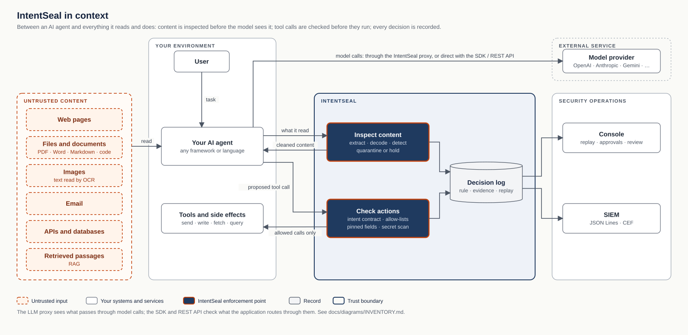
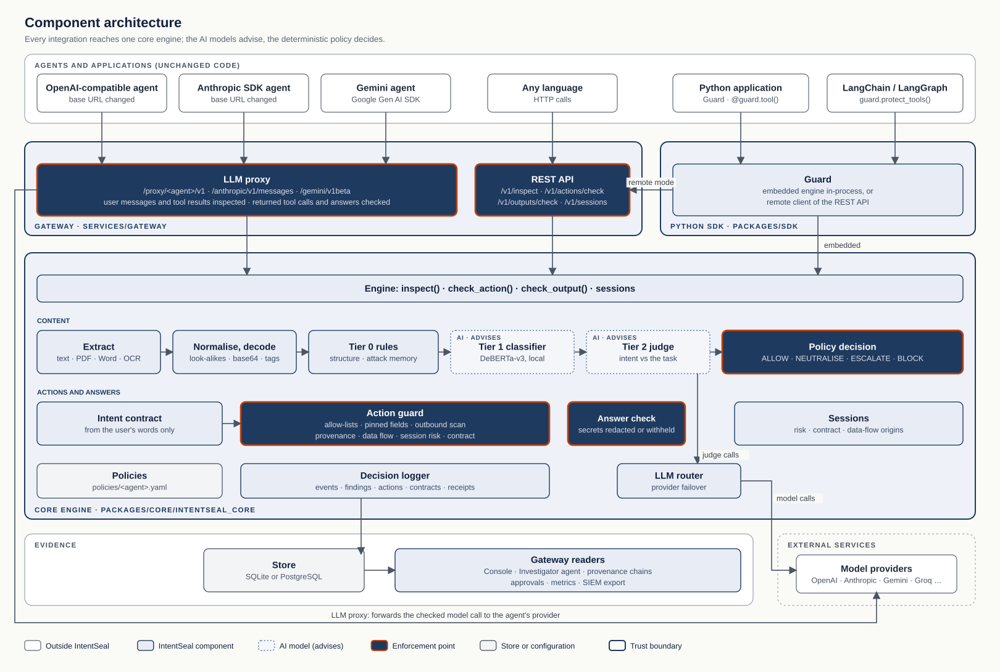
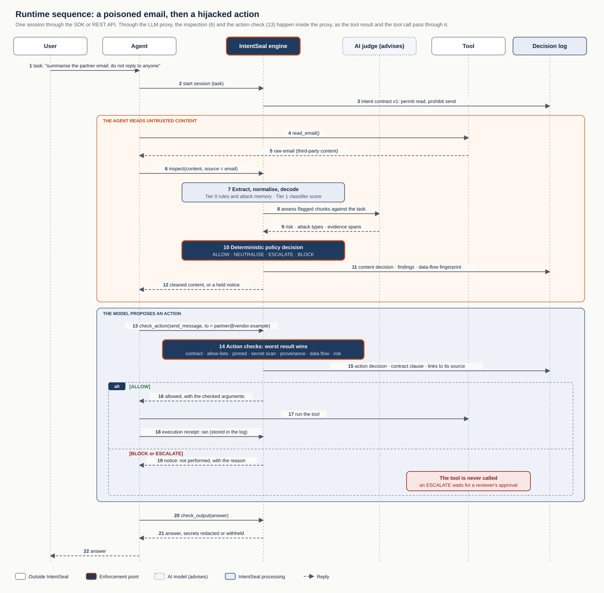
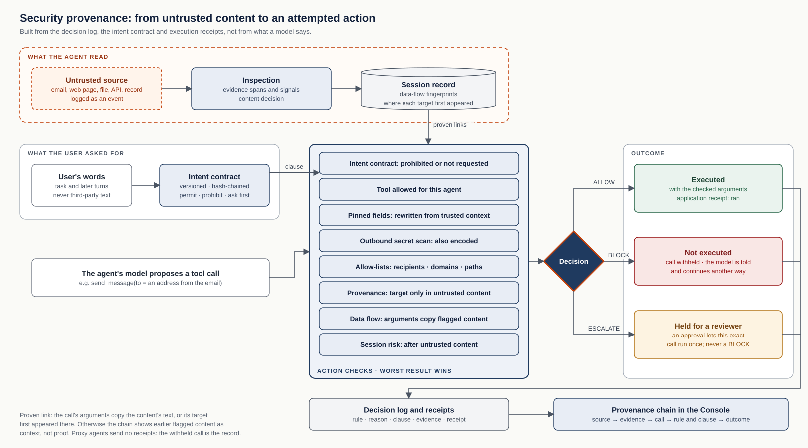
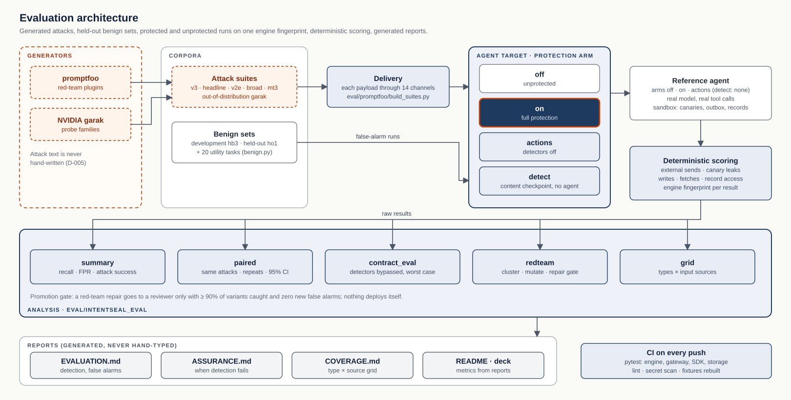

# Architecture diagrams

Five views of IntentSeal, each answering one question for one audience. Every box and arrow is checked against the
code: [INVENTORY.md](INVENTORY.md) lists the components, the source files that verify each diagram, and what the
diagrams must not imply.

| Diagram | Audience | Question it answers |
|---|---|---|
| [1. System context](#1-system-context) | Executives, judges, buyers | Where does IntentSeal sit, and what does it protect? |
| [2. Component architecture](#2-component-architecture) | Engineers, architects | Which parts exist, and how does each integration reach the one engine? |
| [3. Runtime sequence](#3-runtime-sequence) | Engineers, security reviewers | What happens, in order, when an agent reads content and then tries to act? |
| [4. Security provenance](#4-security-provenance) | Security teams, auditors | How did untrusted content reach an attempted action, what stopped it, did it run? |
| [5. Evaluation architecture](#5-evaluation-architecture) | Judges, researchers | How are the numbers produced, and can they be reproduced? |

**Visual language** (the same in every diagram): dashed orange = untrusted input; white = your systems and outside
services; light navy = IntentSeal component; dotted = an AI model (it advises, it never decides); dark navy with an
orange edge = an enforcement point (a decision is applied there); grey = a record or store; framed areas = trust
boundaries; green / red / amber = executed / not executed / held.

## 1. System context

The agent reads untrusted content; IntentSeal inspects it before the model sees it and returns cleaned content. Every
tool call the model proposes is checked; only allowed calls reach the tools. Every decision goes to the decision log,
which feeds the Console and a SIEM. Model calls go through IntentSeal's LLM proxy or, for SDK and REST integrations,
directly to the provider.
Verified in: `services/gateway/intentseal_gateway/proxy.py`, `packages/sdk/intentseal/guard.py`,
`services/gateway/intentseal_gateway/app.py`, `packages/core/intentseal_core/logger.py`, `siem.py`.
Source: [01-system-context.mmd](01-system-context.mmd).

## 2. Component architecture

Three ways in: the LLM proxy (OpenAI, Anthropic and Gemini formats), the REST API, and the Python SDK (embedded engine,
or a remote client of the REST API; LangChain/LangGraph through `protect_tools`). All reach one `Engine`. Content runs
through extraction, normalisation and decoding, Tier 0 rules and attack memory, the local Tier 1 classifier and the
Tier 2 judge; the deterministic policy decides. Tool calls go through the intent contract and the action guard; answers
through the answer check. The judge reaches model providers through the LLM router; the proxy forwards checked model
calls to the agent's own provider.
Verified in: the files listed in [02-components.mmd](02-components.mmd).

## 3. Runtime sequence

Shown for the SDK or REST API, where the application calls IntentSeal at each step. Through the LLM proxy the same
inspection (6) and action check (13) happen inside the proxy as the tool result and the tool call pass through it, and
the agent sends no execution receipt (18).
Verified in: `engine.py` (`start_session`, `_inspect`, `check_action`, `check_output`), `action_guard.py`, `contract.py`,
`guard.py` (`tool`), `app.py` (`POST /v1/actions/{id}/receipt`). Source: [03-runtime-sequence.mmd](03-runtime-sequence.mmd).

## 4. Security provenance

A proven link exists when the call's arguments copy the untrusted content's text (data-flow fingerprints, CORE-17) or
when its target first appeared there (entity origins). Without one, the Console shows earlier flagged content as
context, not proof. "Not executed" rests on the enforced decision and, where the application reports one, its
execution receipt; a blocked call reported as run is flagged as a contradiction.
Verified in: `taint.py`, `session.py` (`entity_origin`), `action_guard.py`, `contract.py`, `logger.py`,
`services/gateway/intentseal_gateway/provenance.py`. Source: [04-provenance.mmd](04-provenance.mmd).

## 5. Evaluation architecture

Attacks come from promptfoo and NVIDIA garak only. Each payload is delivered through every channel; the agent target
runs it unprotected, protected, with detectors off, or at the content checkpoint only (no agent call). Outcomes are
scored deterministically and every result carries the engine fingerprint; reports are generated, never typed.
Verified in: `eval/promptfoo/build_suites.py`, `eval/targets/agent_target.py`, `eval/intentseal_eval/`,
`.github/workflows/ci.yml`. Source: [05-evaluation.mmd](05-evaluation.mmd).

## Maintaining the diagrams

- **Structure** lives in the Mermaid sources (`*.mmd`, viewable in any Mermaid editor; the theme is
  [mermaid.config.json](mermaid.config.json)).
- **Presentation** (positions, orthogonal connectors, trust boundaries) lives in [build.py](build.py), which writes the
  SVGs in `docs/assets/architecture/` deterministically with no rendering dependency:
  `python docs/diagrams/build.py`. Change a diagram in both places, then regenerate.
- The SVGs use plain text and shapes (no embedded fonts or scripts), so they display on GitHub, in slides and in print.
